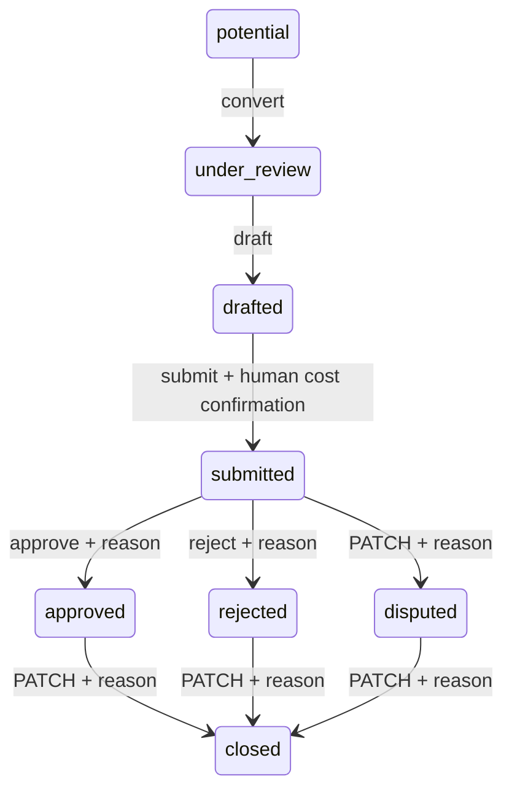

# Change-order workflow (5.3)

The API implements this state machine. All mutations use row locks and atomically
write an `audit_events` entry with actor, project, request ID, reason and before/after
statuses. Change-order audit entries are immutable. Scoped ORM writes require the
checked workflow; a PostgreSQL trigger also blocks skipped/backward state changes.



## Endpoints

| Method | Path below `/api/v1` | Behavior |
| --- | --- | --- |
| POST | `/projects/{project_id}/change-orders` | Create a potential order; optional `source_event_id` copies evidence from a 5.2 potential change |
| GET | `/change-orders/{id}` | Read details, calculated cost, cited draft and approval history |
| PATCH | `/change-orders/{id}` | Edit details before submission, or explicitly dispute/close with a reason |
| POST | `/change-orders/{id}/convert` | Move potential to under_review; evidence required |
| POST | `/change-orders/{id}/draft` | Retrieve project evidence and generate a cited narrative |
| POST | `/change-orders/{id}/submit` | Require a current draft, supported citations and explicitly confirmed human cost inputs |
| POST | `/change-orders/{id}/approve` | Decide a submitted order with a mandatory nonblank reason |
| POST | `/change-orders/{id}/reject` | Reject a submitted order with a mandatory nonblank reason |
| POST | `/change-orders/{id}/export` | Return a paginated PDF attachment and record an export audit event |

Routes require document and financial read permission. Create/cost edits require
financial write, draft/convert/detail edits require change write, submit/dispute/close
require change submit, and approve/reject require approval decide. All accesses are
tenant/project scoped; project membership applies to non-owner/admin roles. An
approver/rejecter must differ from both creator and submitter. Evidence visibility is
checked again on read, draft, submit, decision and export; a hidden/deleted source
hides the order rather than returning partial commercial details.

Create example:

```json
{
  "reference": "CO-53",
  "title": "Relocate drainage",
  "currency": "USD",
  "time_impact_days": 2,
  "cost_items": [
    {"description": "Excavation", "quantity": "3", "unit_rate": "100.005"}
  ],
  "evidence": [{"source_type": "document", "source_id": "DOCUMENT_UUID"}]
}
```

The final amount is `300.02`: multiply each line's quantity and rate, round that
line to two decimals with Decimal ROUND_HALF_UP, then sum. Quantities must be
positive; negative unit rates support credits. Overflow is rejected. Missing inputs
produce an unknown amount. Only human cost inputs are accepted; `amount` cannot be
supplied or patched. Potential-change cost suggestions are never copied into final
cost inputs. Currency is explicit on the order; no conversion is performed.

Submit with `{"cost_confirmed":true}`. Approve/reject with
`{"reason":"Checked against signed instruction"}`. Dispute or close with
`{"status":"disputed","reason":"Entitlement disputed"}` or
`{"status":"closed","reason":"Commercial review complete"}`. Combining a status
transition with detail edits is rejected. Submitted/decided/closed orders are frozen.
Editing a drafted order invalidates its narrative; call draft again before submitting.
Repeated draft generation is supported while drafted; repeated submission/decisions
are rejected. Competing approve/reject requests serialize and only one can succeed.

## Drafting and export

Draft uses the permission-filtered retrieval service with lexical/exact identifier
search, a forced project filter and up to eight source chunks. `query` is optional;
the reference and title form the default query. Missing retrieval evidence blocks
drafting. The service creates append-only evidence links and snapshots citation
labels, link IDs, document IDs, pages and quotations. Every narrative paragraph must
cite supported labels. Unsupported labels, extra output fields, empty citations and
obvious final monetary claims are rejected. Rechecking snapshots blocks submission,
approval or export when a cited chunk changed; regenerate before submission.

When a model provider is configured, the existing gateway drafts narrative only.
Its closed schema has no cost fields, and it never writes the calculated amount.
Without a configured provider, a deterministic quoted-source synopsis supplies the
draft. Both paths require human review. Valid citation IDs do not independently prove
every narrative inference; approval remains a separate human action.

PDF export includes order details and status, human cost items and the backend total,
schedule days, cited narrative, an evidence table and approval history including
decision reasons/actors/timestamps. It checks current source visibility and citation
snapshots, escapes user text, paginates long tables and returns `application/pdf`
with a stable UUID filename and `Cache-Control: no-store`. Export is permitted after
drafting and does not change status. PDF storage, signing and outbound delivery are
outside this feature; the built-in export fonts have limited non-Latin coverage.

## Deployment and compatibility

Install updated dependencies (`reportlab>=4,<5`) and run `alembic upgrade head` before
deploying API/workers. Migration `0013_change_order_workflow` adds source event and
submitter references, cost-input/draft JSON, canonical statuses, state transition and
audit immutability guards. Existing `draft` rows become `drafted`; `executed` rows
become `closed`. Other unsupported legacy statuses fail the new status constraint
and must be reviewed before migration. Legacy rows without line items/cited drafts
cannot be submitted until the human workflow supplies them. Existing evidence IDs
are preserved. Downgrade removes the new fields/guards and maps drafted back to draft;
new workflow history and status distinctions cannot be fully reversed.

There is no reopening, amendment/resubmission, external approval notification,
electronic signature or frontend review workflow in this feature.

## Validation

All 108 workflow tests passed, covering the full state matrix, end-to-end approve,
reject and dispute/close paths, exact financial arithmetic, source-event conversion,
mandatory reasons, cited model drafts, stale/regenerated evidence, multipage escaped
PDF output, role/tenant isolation, atomic audit failures and real concurrent decisions
on independent PostgreSQL connections. Migration round-trip and metadata-drift tests
passed. The final backend run reported **738 passed, 13 skipped, 20 failed**; the 20
failures are the unchanged project-management baseline reproduced earlier in this
session. Ruff E/F/I checks on new modules, dependency consistency and whitespace
checks passed. Live model/OCR/object-storage/Redis integrations and a production
container build were not exercised; model drafting tests use mocked gateway output.

Validation used isolated PostgreSQL 16/pgvector with `DEBUG=false` and
`TEST_DATABASE_ADMIN_URL` set to the disposable server:

```text
backend/.venv/Scripts/python.exe -m pytest backend/tests -q -p no:cacheprovider --basetemp=backend/.venv/workflow-final-full-temp
```
